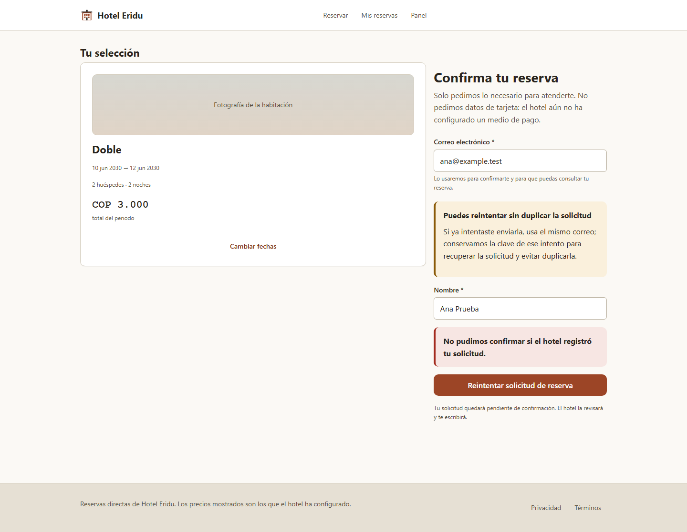
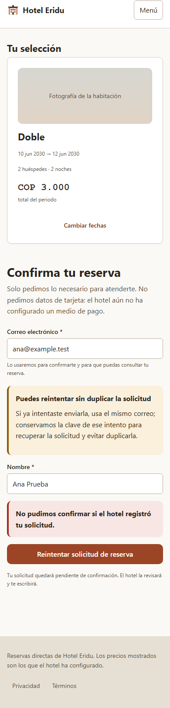

# R234 — Recuperar una reserva si se pierde la respuesta

## Alcance

Cuando un timeout, una caída de red o un error 5xx impide saber si la API alcanzó a guardar la reserva, la página explica cómo repetir el mismo intento. Antes de enviar se conserva en `sessionStorage` únicamente la clave aleatoria de idempotencia; nunca se guarda el correo ni el nombre. Tras recargar, el huésped ve la instrucción de volver a usar el mismo correo y puede reintentar con la misma clave. Los rechazos HTTP definitivos limpian la marca. No cambian API, base de datos, precios ni disponibilidad.

## Prueba de regresión

- La prueba nueva falló primero: el flujo mostraba solo el texto de conexión y no ofrecía una explicación de recuperación.
- Tras el cambio, `PaginaReserva.test.tsx`: **18/18**.
- El escenario simula un error de red, desmonta y vuelve a montar la página, reintenta con el mismo correo y comprueba que ambos cuerpos POST son iguales, conservan `clave-test` y terminan con la reserva recuperada.
- Se verifica que un 400 limpia la marca, que un 503 ofrece el reintento y que el detalle interno simulado (`SQLite database locked`) no aparece en la página.

## Verificación de frontend

En `apps/web`:

| Comando | Resultado |
|---|---|
| `npm test -- --no-file-parallelism src/paginas/PaginaReserva.test.tsx --reporter=dot` | 18/18 |
| `npm test -- --no-file-parallelism --reporter=dot` | 236/236 en 32 archivos |
| `npm run typecheck` | Aprobado |
| `npm run test:typecheck` | Aprobado |
| `npm run build` | Aprobado; Vite transformó 75 módulos |
| En `apps/api`: `.\mvnw.cmd -Dtest=ReservaServiceTest test` | 35/35; incluye los casos de reintento idempotente |
| `git diff --check` | Aprobado |

La corrida completa también mostró una advertencia preexistente de clave React duplicada en `PaginaAdminPanel.test.tsx`, `scrollTo()` no implementado por jsdom y el error `pum` deliberado en la prueba del límite. No causaron fallas.
La prueba Maven recompiló el API desde cero y mostró advertencias del JDK sobre `sun.misc.Unsafe` y acceso nativo de SQLite; terminó con `BUILD SUCCESS`.

## Navegador

Verificación real con Chromium headless sobre el build local y respuestas sintéticas:

| Vista | Viewport | Ancho de documento | Correo conservado | Mensaje de recuperación | Errores JS |
|---|---:|---:|---|---|---:|
| Escritorio | 1440 × 1000 | 1440 px | Sí | Sí | 0 |
| Móvil | 390 × 844 | 390 px | Sí | Sí | 0 |

La API simulada respondió `200` a `/api/hotel`, `401` a `/api/yo` y `/api/admin/sesion` (sesiones anónimas), y `503` a `POST /api/reservas` con un detalle interno ficticio. La consola solo registró esos estados HTTP sintéticos; no hubo errores de ejecución JavaScript. La marca conservada fue únicamente `r234-fixture-key`, sin correo.

