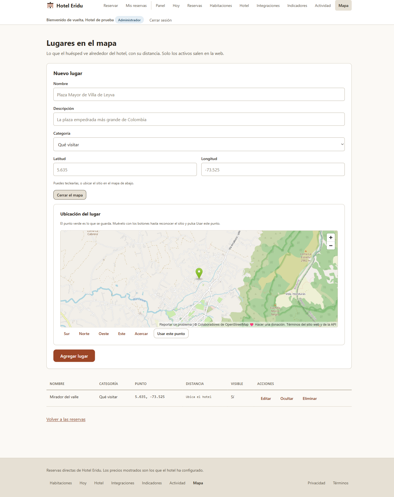
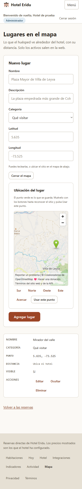

# R235 — Ubicar lugares sin copiar coordenadas

## Cambio

La pantalla administrativa de lugares permite abrir un mapa centrado en la ubicación configurada del hotel. El marcador se ajusta con controles accesibles Norte, Sur, Este y Oeste; acercar reduce el área visible. Las coordenadas del formulario se actualizan al mover el marcador, así que el mismo punto se muestra en el mapa y se envía al guardar. La configuración del hotel y cada lugar usan un selector compartido. El marco del mapa tiene un nombre accesible que explica su propósito.

No se modificaron API, modelo de datos, persistencia ni reglas de distancia.

## Pruebas y build

En `apps/web` sobre el `develop` actualizado:

| Comando | Resultado |
|---|---|
| `npm test -- --no-file-parallelism src/paginas/PaginaAdminHotel.test.tsx src/paginas/PaginaAdminLugares.test.tsx --reporter=dot` | 12/12 |
| `npm test -- --no-file-parallelism --reporter=dot` | 237/237 en 32 archivos |
| `npm run typecheck` | Aprobado |
| `npm run test:typecheck` | Aprobado |
| `npm run build` | Aprobado; Vite transformó 76 módulos |
| `git diff --check` | Aprobado |

La prueba nueva falló inicialmente porque el marco no exponía un nombre que indicara que el mapa permite elegir el punto. Tras corregirlo, la prueba cubrió que el mapa aparece y que pulsar Norte modifica la latitud. La corrida completa conserva advertencias preexistentes: una clave React duplicada en `PaginaAdminPanel.test.tsx`, el error `pum` deliberado en el test del límite de error y `scrollTo()` no implementado por jsdom. No produjeron fallos.

## Navegador

Chromium contra el servidor local de Vite, con sesión administrativa y datos sintéticos de un hotel y un lugar:

| Vista | Viewport | Ancho del documento | Resultado |
|---|---:|---:|---|
| Escritorio | 1440 × 1000 | 1425 px (incluye la barra vertical) | Mapa cargado, controles visibles y sin desbordamiento horizontal |
| Móvil | 390 × 844 | 390 px | Mapa cargado al desplazarse hasta él; controles envuelven en dos filas, sin desbordamiento horizontal |

Al pulsar Norte desde la ubicación inicial, la latitud y el marcador cambiaron juntos a `5.655`. El `iframe` se anuncia como “Mapa para elegir el punto: ubicación del lugar”. La consola no registró excepciones JavaScript; mostró dos respuestas `401` de `/api/yo` para la sesión de huésped anónima y mensajes informativos de Vite/React.

