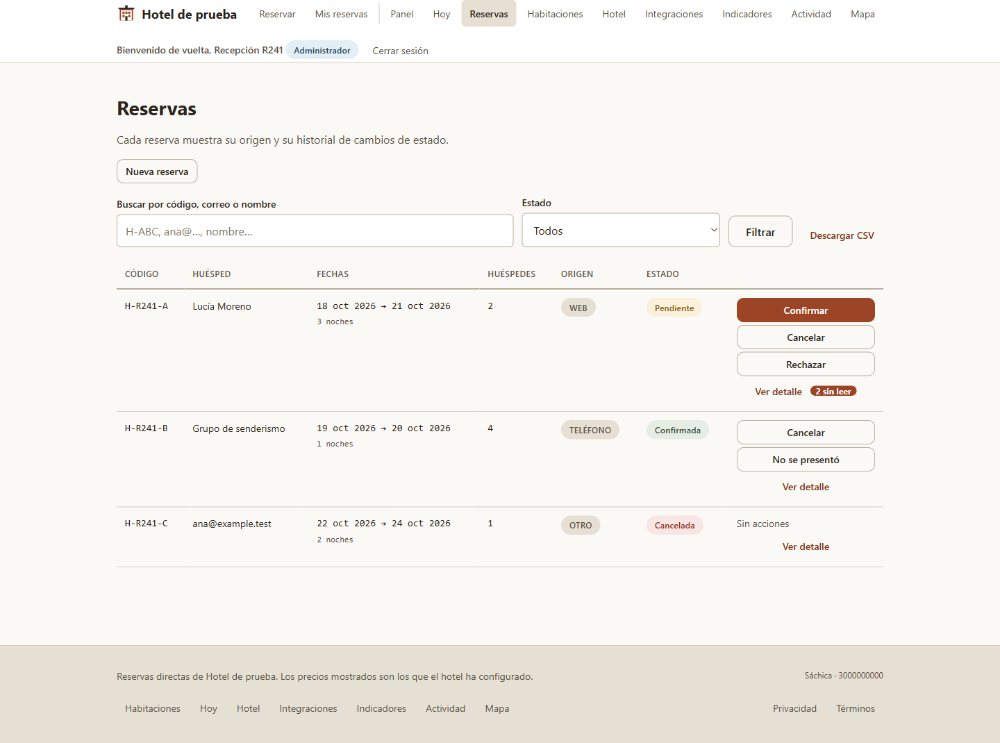
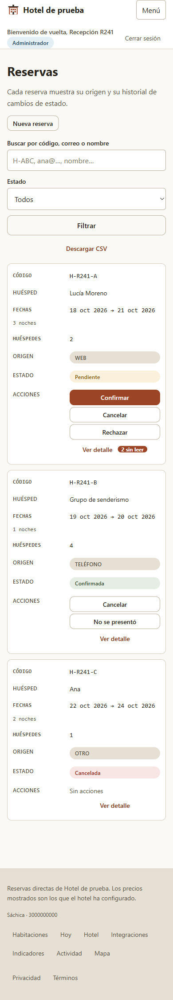

# R241 — Verificación de la tabla de reservas

## Resultado

Se extrajeron la tabla y las acciones por fila a `TablaReservas.tsx`. La pantalla conserva las llamadas API, los filtros, la carga periódica, los cambios de estado y el detalle en `PaginaAdminReservas.tsx`. Las acciones visibles continúan dependiendo exclusivamente de `siguientes`, el campo provisto por el servidor.

## Pruebas y build

- RED: antes de crear `TablaReservas.tsx`, Vitest falló al resolver esa importación desde la prueba nueva. La falla correspondía al componente ausente.
- Componente y página: **18/18 pruebas** en los dos archivos dirigidos.
- Suite frontend: **258/258 pruebas**, 34 archivos, código de salida 0.
- `npm run typecheck`: código 0.
- `npm run test:typecheck`: código 0.
- `npm run build`: código 0; Vite transformó 77 módulos y generó el bundle.
- `git diff --check`: código 0.

Vitest imprimió `Not implemented: Window's scrollTo() method` y una nota sobre el tiempo de creación de los entornos jsdom. La suite terminó con código 0; no hubo fallos ni errores de pruebas.

## Tamaño de la página

| Archivo | Antes de R241 | Después de R241 |
|---|---:|---:|
| `PaginaAdminReservas.tsx` | 756 líneas físicas (719 con contenido; `d48d12f`) | 644 líneas físicas (613 con contenido) |
| `TablaReservas.tsx` | — | 134 líneas físicas (125 con contenido) |

La página se redujo en **112 líneas físicas (14,8 %)**. Es una separación de responsabilidades; al sumar el nuevo componente no se afirma una reducción neta del código total.

## Revisión visual

La aplicación del worktree se abrió localmente en Chrome con respuestas sintéticas para tres reservas. No se consultó la API ni se usaron datos reales.

- Escritorio: viewport 1440×1000; tres filas visibles en orden, acciones, estados y conteo accesible «2 mensajes sin leer». El documento mide 1425 px de ancho frente a 1440 px de viewport; no hay desbordamiento horizontal.
- Móvil: viewport 390×844; las tres reservas se presentan como tarjetas legibles con etiquetas de columna y acciones dentro de cada tarjeta. `scrollWidth` y `clientWidth` dan 390 px; no hay desbordamiento horizontal.
- Consola Chrome: dos mensajes `debug` de Vite y un mensaje informativo de React DevTools; **cero errores y advertencias**.

### Escritorio

### Móvil

## Alcance de la verificación

Se verificó la tabla integrada, su visualización en escritorio/móvil y sus pruebas de contrato. No se modificaron reglas de dominio, endpoints, base de datos ni estilos.

## Integración y publicación

- Commit de la rama de trabajo `9f51a7c` cherry-picked a `develop` como `f382f7924de748bd4d3d756d139b57d30f31074f`.
- Después de integrar: suite frontend 258/258; `typecheck`, `test:typecheck` y build (77 módulos), todos con código de salida 0.
- `origin/develop` y GitHub apuntan a `f382f7924de748bd4d3d756d139b57d30f31074f`.
- GitHub reporta `author.login=jdsalasca`; autor y committer son `JUAN DAVID SALAS CAMARGO <31742974+jdsalasca@users.noreply.github.com>`.
- Worktree `r241-lista-reservas` y rama `codex/r241-lista-reservas` retirados; `git worktree prune` ejecutado. Los otros worktrees se conservaron.
