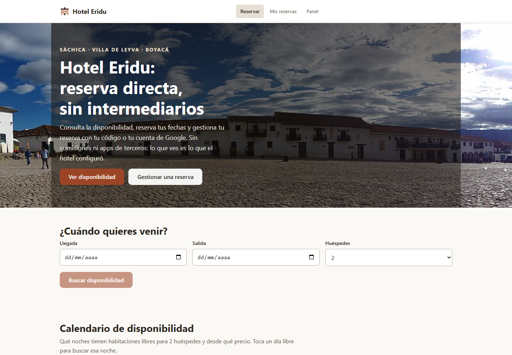
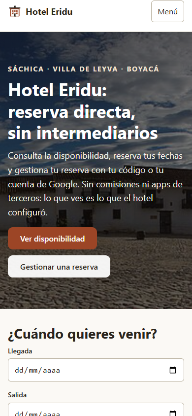

# R242 — Tokens semánticos de color SCSS

## Resultado

Los colores que estaban escritos directamente en `_base.scss`, `_chat.scss`, `_componentes.scss` y `_mixins.scss` ahora se nombran mediante tokens centralizados en `_tokens.scss`. Un test recursivo recorre los parciales SCSS y rechaza hexadecimales, funciones cromáticas y `transparent` fuera del archivo central.

Es una refactorización de estilos: no altera el diseño compilado, no cambia el comportamiento de la aplicación y no incorpora tema oscuro/claro. Ese tema sigue aplazado hasta que el producto esté terminado.

## Verificación

- **RED/GREEN:** la prueba nueva encontró inicialmente 47 usos literales fuera de `_tokens.scss`; tras la migración pasó. Repetición final: `npx vitest run src/styles/tokens-colores.test.ts`, 1/1.
- **Búsqueda independiente:** cero coincidencias para hexadecimales, funciones de color y `transparent` en archivos `.scss` distintos de `_tokens.scss`.
- **Equivalencia de CSS:** Sass compiló `indice.scss` en la revisión base `4d10fe1` y en esta ronda. Ambos resultados tienen 33.967 bytes y SHA-256 `d4b15b292c63ffa0b5a878132443ef914ce82d9bd0451e72f2499e5379816204`; los textos de salida también son idénticos.
- **Suite integrada en `develop`:** `npm test`, 259/259 pruebas en 35 archivos, código 0. Vitest imprimió el aviso ya conocido de `Window.scrollTo()` no implementado y una nota de duración acumulada de jsdom; la suite terminó aprobada.
- **Tipos y build integrados:** `npm run test:typecheck` terminó con código 0. `npm run build` ejecutó `tsc --noEmit` y Vite terminó con código 0: 77 módulos, CSS 26,73 kB (5,53 kB gzip) y JS 405,94 kB (116,38 kB gzip).
- **Higiene:** `git diff --check` terminó con código 0.

## Revisión visual en navegador

Se abrió la portada local de desarrollo en Chromium; no se consultó producción ni se modificaron datos. El backend local respondió 200 para los datos públicos de hotel, lugares y calendario. Al visitar como usuario anónimo, `/api/yo` y `/api/admin/sesion` respondieron 401, que es el comportamiento esperado de esas consultas de sesión. La consola no registró excepciones de JavaScript ni advertencias.

- Escritorio: viewport **1440×1000**; documento **1440 px**, sin desbordamiento horizontal.
- Móvil: viewport **390×844**; documento **390 px**, sin desbordamiento horizontal.

### Escritorio

### Móvil

## Integración y publicación

- Commit de trabajo `8db9fa6` cherry-picked en `develop` como `6912425`.
- Suite frontend, chequeo de tipos y build repetidos después de integrar; todos terminaron con código 0.
- `origin/develop` recibió `6912425`. GitHub confirmó `author.login=jdsalasca` y `committer.login=jdsalasca`; ambos usan `JUAN DAVID SALAS CAMARGO <31742974+jdsalasca@users.noreply.github.com>`.
- No se modificaron los otros worktrees.
